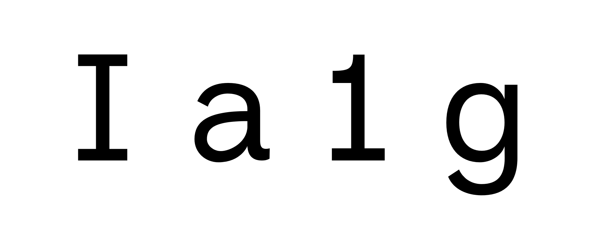

# Bersih Text Font
Bersih Text font is a customized version of Inclusive Sans font, with double-storey "a" rather than single-storey to distinguish it from lowercase "o". The "Bersih" means "Clean" in Indonesian, where its name is related with accessibility and readability.

## Future plans
I would like to add Greek and Cyrillic scripts, and other glyphs (inluding few Latin-1 supplement symbols, superscript & subscript, and vulgar fractions at next time.
